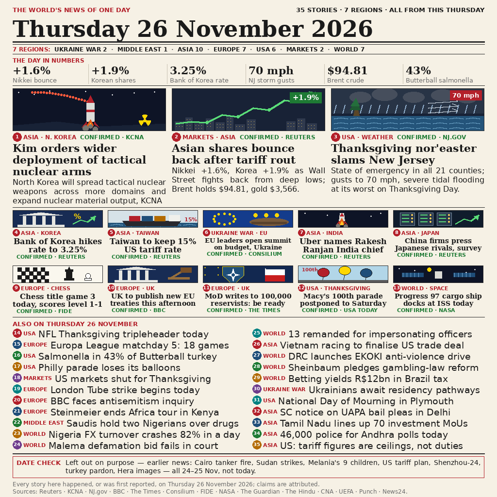

# Thursday 26 November 2026 — 35 stories, 7 regions

[](https://make.fun/bounty/news-image-20261126?utm_source=github&utm_medium=readme&utm_campaign=news-image-20261126)
[](https://make.fun/bounty/news-image-20261126/leaderboard?utm_source=github&utm_medium=readme&utm_campaign=news-image-20261126)
[](https://make.fun/bounty/news-image-20261126?utm_source=github&utm_medium=readme&utm_campaign=news-image-20261126)

Entry for the [make.fun news-image-20261126 bounty](https://make.fun/bounty/news-image-20261126):
a one-day front page — **35 stories, 7 regions, all from Thursday 26 November 2026**.



## What's inside

- **3 leads:** Kim orders wider deployment of tactical nuclear arms · Asian shares
  bounce back after tariff rout · Thanksgiving nor'easter slams New Jersey
- **10 minis:** Bank of Korea hikes to 3.25% · Taiwan keeps 15% US tariff ·
  EU leaders open summit on budget, Ukraine · Uber names Rakesh Ranjan India
  chief · China firms press Japanese rivals · Chess title game 3 today ·
  UK to publish new EU treaties · MoD writes to 100,000 reservists ·
  Macy's 100th parade postponed · Progress 97 docks at the ISS
- **22 briefs:** NFL Thanksgiving tripleheader · Europa League matchday 5 ·
  Butterball salmonella · Philly parade loses its balloons · US markets shut ·
  Tube strike · BBC antisemitism inquiry · Steinmeier ends Africa tour ·
  Saudi arrests · Nigeria FX crash · Malema bid fails · Ghana remands ·
  Vietnam trade deal · DRC EKOKI drive · Sheinbaum gambling reform ·
  Brazil betting tax · Ukrainians await residency · Day of Mourning ·
  UAPA bail pleas · Tamil Nadu MoUs · Andhra polls · US tariff ceilings

**Regions:** UKRAINE WAR 2 · MIDDLE EAST 1 · ASIA 10 · EUROPE 7 · USA 6 ·
MARKETS 2 · WORLD 7.

## Date discipline

Every story happened, or was first reported, on Thursday 26 November 2026.
Stories from 24–25 Nov (Cairo tanker fire, Sudan strikes, Melania's 9 children,
the US tariff proposal itself, Shenzhou-24, the turkey pardon, Hera images…)
were checked and deliberately left out — see the date-check box on the page
and the full list in [`research.md`](research.md).

## How it was built

The front page is drawn entirely in code (`build_26nov.py`, Python + PIL):
dark ink on light paper, no map, legible at 390px. `main.py` copies the
rendered `entry.png` (1024×1024 RGB, ≤1 MiB) to `/output/entry.png` with
size + sha256 verification. Rebuild with:

```sh
python3 build_26nov.py
```
